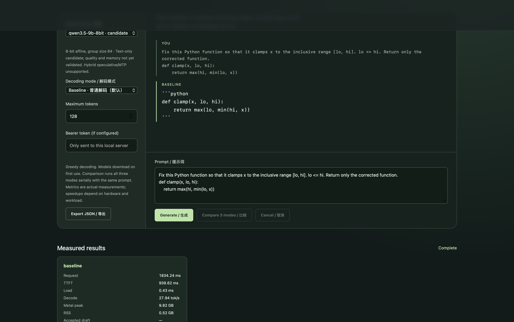

# DeepInfer-Mac

**让本地模型，更懂你的 Mac。** 以 MLX 为执行后端、以 DeepInfer 方法驱动自适应调度的 Apple Silicon 本地推理框架。

[English](README.md) · [展示站](https://zevin17.github.io/deepinfer-mac/zh.html) · [真实回放](https://zevin17.github.io/deepinfer-mac/phase2.html) · [兼容说明](docs/compatibility.md) · [参与贡献](CONTRIBUTING.md)

在终端运行模型，接入流式聊天 API，或打开内置浏览器工作台。探索根据草稿、验证与恢复的完整实测成本进行决策的执行方式。Qwen3.5-9B 是首要演示载体；模型与缓存能力才是框架的接口边界。

[](https://zevin17.github.io/deepinfer-mac/phase2.html)

*真实 Qwen3.5-9B-8bit 请求，M4 Pro / 24 GiB。[查看录制的 SSE 响应回放](https://zevin17.github.io/deepinfer-mac/phase2.html)；展示站不执行模型推理。*

- **连贯的本地工作流。** CLI、Python、兼容 OpenAI 的聊天 API 子集与本地 UI 共用引擎。
- **可以接续的上下文。** 限额缓存、原生 MLX-LM LRU 与精确混合状态快照共同管理已消费前缀。
- **可以核查的调度。** 实验自适应路径将经验接受率、完整周期成本连接到 DeepInfer 派生预算决策，并由原始 C++ 参考核验。

## 快速上手

需要支持 Metal 的 Apple Silicon Mac、Python 3.12/3.13 与 [uv](https://docs.astral.sh/uv/)。权重按锁定 revision 单独下载，为权重、活跃状态、快照及 macOS 预留内存。

```sh
git clone --branch codex/phase2-core --single-branch https://github.com/ZEVIN17/deepinfer-mac.git
cd deepinfer-mac
uv sync --frozen --extra mlx
uv run deepinfer-mac doctor
uv run deepinfer-mac models --download qwen3.5-9b-8bit --target-only
uv run deepinfer-mac run --profile qwen3.5-9b-8bit --mode baseline '用中文解释统一内存。'
uv run deepinfer-mac serve
```

打开 **http://127.0.0.1:8765**，选择 `qwen3.5-9b-8bit`。默认 profile 是较小的 `qwen3-4b` 回归模型。baseline 支持 temperature、top-p、top-k、presence penalty 与 seed。运行 `uv run deepinfer-mac models --json` 查看 profile 元数据。

命令使用实验源码分支。已有 checkout 可执行 `git switch codex/phase2-core`、`git pull --ff-only`，再运行 `uv sync --frozen --extra mlx`；更新前保留本地修改。[v0.1.0a1](https://github.com/ZEVIN17/deepinfer-mac/releases/tag/v0.1.0a1) 是已发布的历史版本，0.1.0a2 仍为候选包，当前不假设 PyPI 已发布。

## 接入引擎

```python
from deepinfer_mac.engine import InferenceEngine
from deepinfer_mac.state import GenerationRequest

engine = InferenceEngine()
try:
    result = engine.generate(GenerationRequest(
        profile="qwen3.5-9b-8bit", prompt="Explain unified memory.",
        mode="baseline", max_tokens=128,
    ))
    print(result.text)
finally:
    engine.close()
```

启动 `serve` 后调用流式 API：

```sh
curl http://127.0.0.1:8765/v1/chat/completions \
  -H 'Content-Type: application/json' \
  -d '{"model":"qwen3.5-9b-8bit","messages":[{"role":"user","content":"Hello"}],"max_tokens":128,"temperature":0,"stream":true}'
```

服务提供约定的聊天 API 子集、有界排队、取消与流式输出。当前生产服务由单一推理 owner 执行；并发执行准入及 DS 跨请求预算属于第三阶段工作。

## 实验接口：接入其他模型

新的能力适配接口已实现本地模型目录或精确 repo revision 注册，仍在进行第三阶段真实模型验收。已有完整 MLX 模型目录时可使用：

```sh
uv run deepinfer-mac run --model /path/to/complete-mlx-model \
  --model-id my-local-model --max-tokens 32 'Hello'
```

模型按进程显式注册；自定义模型初始为未验证的 baseline 兼容性，不支持的优化会被拒绝。JSON 配置可让 CLI、Python、API 使用同一 ID。[适配器文档](docs/MODEL_ADAPTERS.md)说明身份、资源保护及显式回退。

## 模型与执行能力

“已验证”仅对应表中具体路径，不外推到 MLX-LM 支持的全部模型与优化。

| 模型 / 路径 | 本地 baseline | 自适应路径 | 验证范围 |
|---|---|---|---|
| Qwen3.5-9B-8bit | 已验证 CLI / API / UI、采样 | 实验功能，显式开启 | 首要文本演示；混合状态 |
| Qwen3.5-9B-4bit | 已验证 baseline / native 控制 | 公开入口未开启 | 同模型质量 / 内存对照 |
| Qwen3-14B-4bit | 已验证 baseline / native 控制 | 待验证 | Dense 工程对照 |
| Qwen3-4B | 已验证回归路径 | 实验 fixed / adaptive | 较小的 Dense 回归模型 |
| 可配置模型 / 缓存适配器 | 实验接口已实现 · 真实模型验收中 | 按能力开放 baseline | 路径 / repo 注册、透明 baseline 回退 |
| 跨请求预算 / 状态流水 | 第三阶段构建中 | — | 尚非当前默认服务能力 |

公开 9B API/UI 仍只开放 baseline。混合推测限定 greedy，通过 [DS 方法映射](docs/DS_DESIGN_MAPPING.md) 中的显式实验入口使用。模型成功加载、任务质量与优化验证分别记录。参见[模型选择](docs/PHASE2_MODEL_SELECTION.md)、[兼容说明](docs/compatibility.md)及不可变 [模型锁](models.lock.json)。

## 已验证的工程成绩

| 真实工作负载 | 结果 | 证据 |
|---|---|---|
| 9B 自适应开发轨迹 | 28/28 次成熟决策与原始 C++ 一致；128 个输出 token 与 baseline 一致 | [补充核验](benchmarks/reports/phase2-hybrid-lagged-dev-qwen35-9b8-supplemental-verification.json) |
| 9B 上下文复用 | 20 次请求；两种采样设置下 16/16 项完整 token 检查通过 | [缓存报告](benchmarks/reports/phase2-message-checkpoints-qwen35-9b8.json) |
| M4 Pro / 24 GiB 上的 9B baseline | 4,204 输入 + 256 输出；该次运行未观测到 swap 增量 | [资源检查](benchmarks/reports/context-4204-256-qwen35-9b8.json) |

上述为正确性与资源成绩。尚未确立相对原生 MLX-LM、oMLX 的稳定性能优势，竞争性能目标延续至第三阶段。[基准协议](docs/benchmarking.md)和[二阶段完整记录](docs/phase2.md)保留条件、失败样本与历史结论。

## 自适应执行如何协作

```text
CLI / Python / 聊天 API / 本地 UI
                  │
            模型 + 缓存能力
                  │
          MLX / MLX-LM 执行
                  │
        草稿 → 目标验证 → 精确恢复
          ↑    接受率 + 完整成本 │
          └── DeepInfer 派生预算 ┘
```

当前自适应实现调度单个请求。第三阶段将其扩展为跨请求预算、真实变长验证与经过时间线验证的状态重叠。构建[本地展示站](site/README.md)即可查看交互式预算图：明确标为机制示意，与实测轨迹分开。

MLX / MLX-LM 提供模型执行、采样和原生 LRU；DeepInfer 提供参考调度方法；混合状态恢复与服务集成属于 Mac 适配。本项目为独立社区实现。[架构](docs/architecture.md) · [源码映射](docs/DS_DESIGN_MAPPING.md) · [第三方归属](NOTICE) · [Apache-2.0](LICENSE)。

## 开发与复现

```sh
uv sync --frozen --extra mlx --extra dev
uv run pytest -q
uv run pytest -q --run-metal -m metal
python3 site/build.py
python3 site/check.py
```

[贡献指南](CONTRIBUTING.md) · [版本说明](docs/release-notes.md) · [证据索引](docs/evidence.md) · [第三阶段执行方案](docs/PHASE3_EXECUTION_PLAN.md)

后续实现顺序为：能力适配器 → 请求 tick 与资源准入 → 跨请求验证预算 → 时间线驱动重叠 → 两框架公平对照。二阶段报告及冻结产物保持原样。
